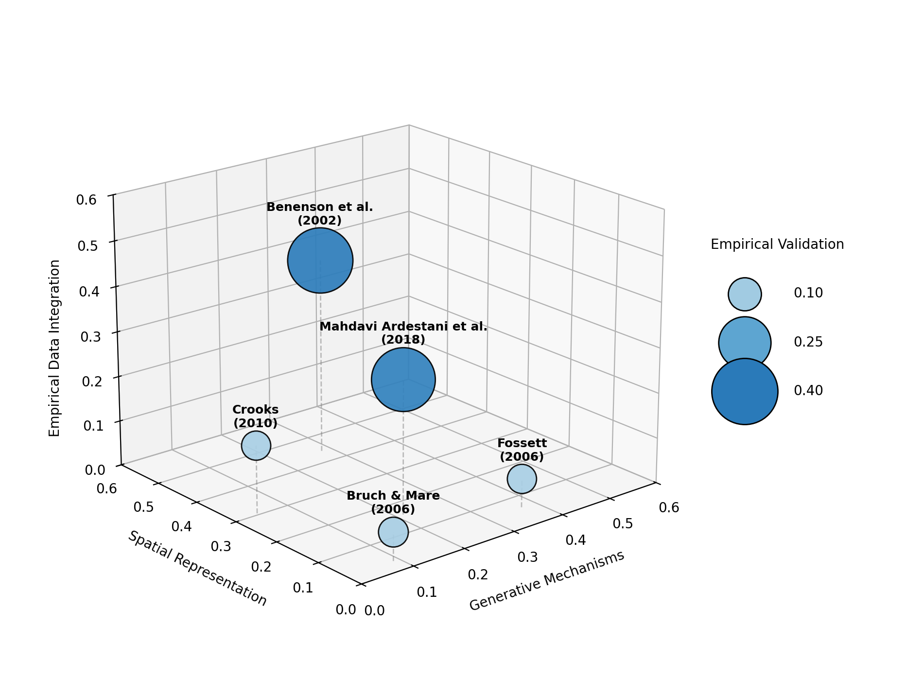
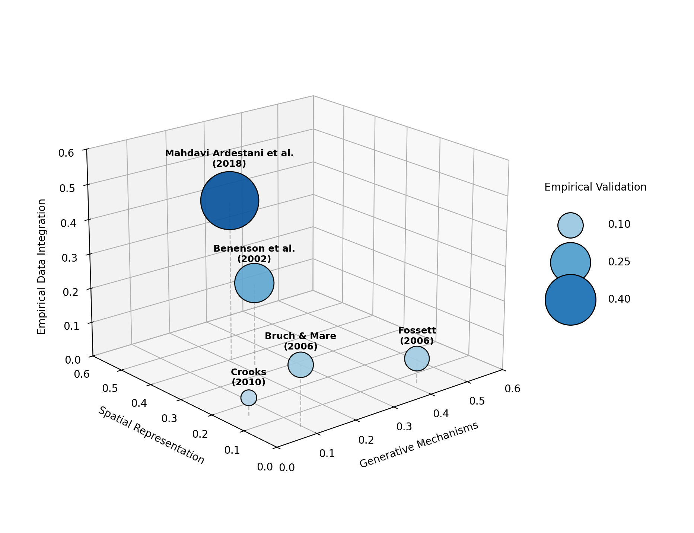
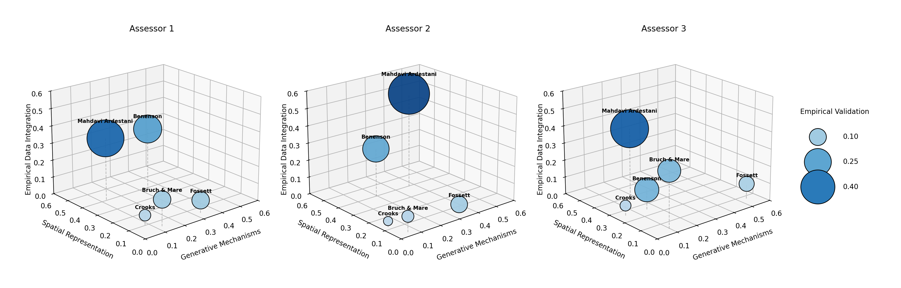

# Quantifying Realism in Urban Simulation: supporting materials

This repository holds the supporting materials for:

> Babak Mahdavi Ardestani (2026). *Quantifying Realism in Urban Simulation: An AHP-Based Framework for Model Selection and Evaluation.* Journal of Artificial Societies and Social Simulation, [volume(issue)]. [DOI of the published paper]

Archive (all versions): [Zenodo DOI]

The framework in the paper compares simulation models on *structural realism* across four dimensions: Generative Mechanisms, Spatial Representation, Empirical Data Integration and Empirical Validation, using the Analytic Hierarchy Process (AHP). This is demonstrated on five residential segregation models. Please keep in mind that the scores are structured assessments made under stated criteria, evidence and judgements. They are not direct measurements of realism.

## Contents

| File | Description |
|---|---|
| `Independent_Assessment_Guide.pdf` | The guide sent to the independent assessors. It describes the five models, sets out the evidence for each dimension, and explains how to make the pairwise comparisons. Reproduced in Appendix A of the paper. |
| `Independent_Assessment_Form.docx` | The blank electronic form the assessors used to record their pairwise judgements (Appendix A). |
| `replication_script.py` | Reproduces the numerical results in the paper from the pairwise comparison matrice. |
| `figures/` | Bubble plots of the local priorities (see below). |

Completed assessor forms are not shared, to protect anonymity. The judgements themselves are given in full as matrices in Appendix C of the paper and in `replication_script.py`, labelled Assessor 1–3 with no link to individuals.

## Reproducing the results

Requirements: Python 3.8+, `numpy`, `scipy`.

```
python replication_script.py
```

## Figures

Each figure plots the five models by their local priorities on Generative Mechanisms (x), Spatial Representation (y) and Empirical Data Integration (z). Bubble size and colour show the local priority on Empirical Validation. Because local priorities are independent of the dimension weights, the same plot can be drawn for any set of judgements. The coordinates are the local priorities printed by `replication_script.py`.

**Baseline**: the author's own single-assessor assessment with equal dimension weights. Treat this as an illustrative reference rather than independent evidence:



**Independent panel**:  the three assessors' judgements aggregated with AIJ:



**Individual assessors:**



Note that the figures show local priorities only. Overall rankings also depend on the weights each assessor gave to the dimensions, which differ between the baseline and the panel, see Tables 2 and 3 and Appendix D of the paper.


## Status

Supporting materials for a paper accepted for publication in the Journal of Artificial Societies and Social Simulation. Full citation details and a DOI will be added after publication.


## Citation

If you use these materials, please cite both the paper and this archive:

- Paper: Mahdavi Areestani, B. (2026). Quantifying Realism in Urban Simulation: An AHP-Based Framework for Model Selection and Evaluation. Journal of Artificial Societies and Social Simulation, [volume(issue)]. https://doi.org/[paper DOI]
- Archive: Mahdavi Areestani, B. (2026). Supporting materials for "Quantifying Realism in Urban Simulation: An AHP-Based Framework for Model Selection and Evaluation" [Computer software and documents]. Zenodo. [Zenodo DOI]

The archive DOI resolves to the latest version. GitHub's "Cite this repository" button gives a ready-made citation from `CITATION.cff`.

## Licence

Code: MIT, see `LICENSE`.
Guide, form, figures: CC BY 4.0, see `LICENSE-CC-BY.txt`.


## Author & Contact

**Babak Mahdavi Ardestani**  
* Email: [babak.mahdavi@mail.mcgill.ca](mailto:babak.mahdavi@mail.mcgill.ca)
* GitHub: [@babak2](https://github.com/babak2)
* ORCID: [0000-0001-7591-3208](https://orcid.org/0000-0001-7591-3208)
